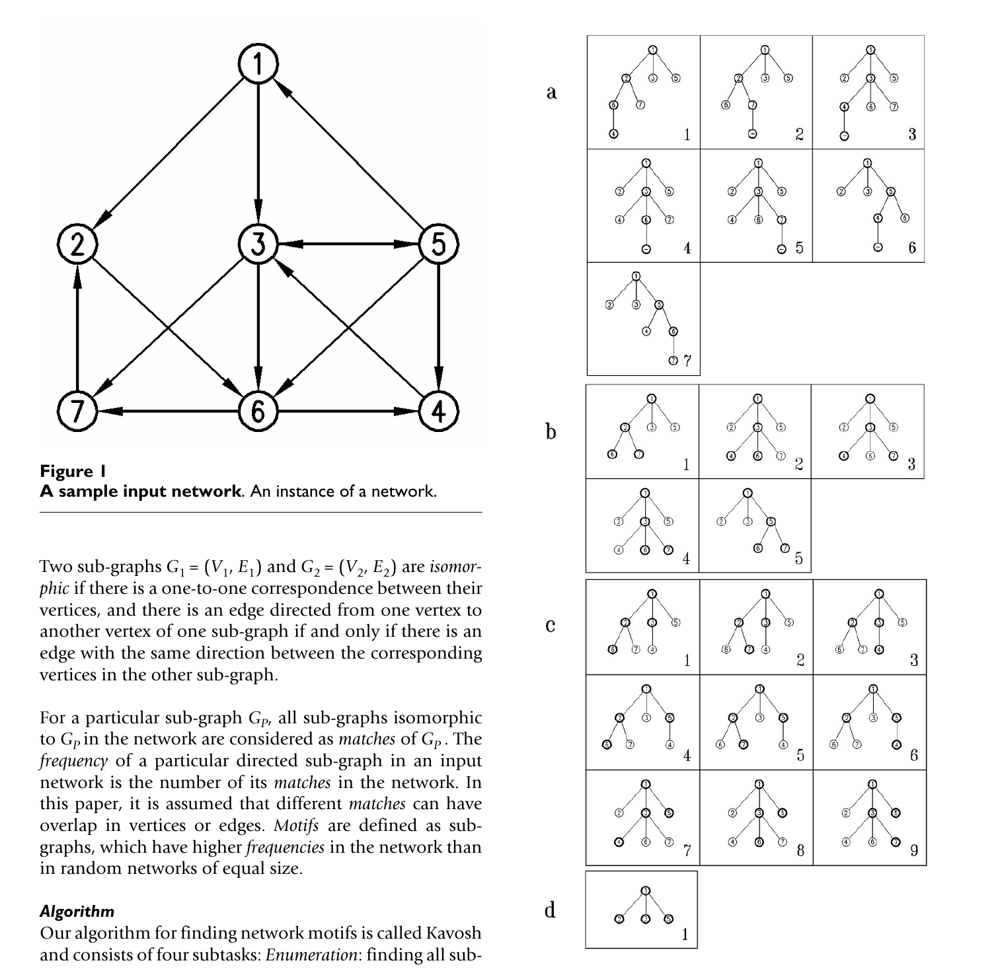

# Kavosh

**Exact enumeration and statistical evaluation of network motifs.**

Kavosh finds every connected sub-graph of a given size in a directed or undirected
network, groups those sub-graphs into isomorphism classes, and scores each class
against a degree-preserving random ensemble. Classes that occur significantly more
often in the real network than in the ensemble are its *network motifs*.

Kavosh was designed to keep memory use low at larger motif sizes. It enumerates
sub-graphs by walking an implicit tree rooted at each vertex rather than
materialising candidate sets, and delegates isomorphism testing to
[nauty](https://pallini.di.uniroma1.it/). On the networks used in the paper it
matched or beat the then-current tools (FANMOD, Mfinder, MAVisto) in both time
and memory, and reached motif sizes those tools could not.

<p align="center">
  
</p>

<sub><b>Left:</b> a sample directed network. <b>Right:</b> the implicit trees Kavosh
builds when enumerating size-4 sub-graphs rooted at vertex 1, grouped by composition
pattern: (a) (1,1,1), (b) (1,2), (c) (2,1), (d) (3). Each pattern fixes how many
vertices are drawn from each depth level, so every sub-graph is generated exactly once.
Figure 2 of Kashani <i>et al.</i> (2009), reproduced under
<a href="https://creativecommons.org/licenses/by/2.0/">CC BY 2.0</a>.</sub>

---

## How it works

Kavosh runs four stages:

| Stage | What it does |
| --- | --- |
| **Enumeration** | For each vertex `u`, build the implicit tree of connected sub-graphs of size `k` containing `u`, then remove `u` so no sub-graph is counted twice. Composition patterns of `k-1` partition the search by how many vertices come from each tree level. |
| **Classification** | Canonicalise each enumerated sub-graph with nauty and accumulate counts per isomorphism class. |
| **Random ensemble** | Generate random networks by repeated edge switching, which preserves every vertex's in- and out-degree. |
| **Motif identification** | Compute a Z-score per class from its real count against the ensemble mean and standard deviation. |

## Requirements

- A C++17 compiler (GCC 7+ or Clang 6+)
- GNU Make

No external libraries. nauty 2.2 is vendored under `nauty/`.

## Build

```bash
git clone https://github.com/shmohammadi86/Kavosh.git
cd Kavosh
make
```

This produces the `Kavosh` executable in the repository root. To verify the build:

```bash
make check
```

To install system-wide:

```bash
sudo make install              # installs to /usr/local/bin
make install PREFIX=$HOME/.local   # or somewhere on your own PATH
```

## Usage

```
Kavosh -i <INPUT> -s <SIZE> [-r <N>] [-o <DIR>]

  -i, --input   FILE   input network (required)
  -s, --size    INT    motif size, number of vertices (required)
  -r, --random  INT    number of random networks in the ensemble (default: 0)
  -o, --output  DIR    output directory (default: result)
  -h, --help           show this message
```

### Input format

A plain text file. The first line is the number of vertices. Every following line
is one directed edge, given as two whitespace-separated vertex IDs in `1..N`:

```
688
1	194
4	8
4	20
```

Self-loops are ignored. Three sample networks ship in `networks/`:

| File | Network | Vertices |
| --- | --- | --- |
| `yeast` | *S. cerevisiae* transcriptional regulatory network | 688 |
| `elec` | Electronic circuit (`s208`) | 252 |
| `social` | Social network | 67 |

### Example

Find size-3 motifs in the yeast transcription network against 100 random networks:

```bash
./Kavosh -i networks/yeast -s 3 -r 100 -o result
```

### Output

Two files land in the output directory.

**`adjMatrix.txt`**: one block per isomorphism class, giving the class adjacency
matrix and its integer ID:

```
000
001
110
ID: 38
```

**`ZScore.txt`**: one row per class:

```
ID     NUM IN REAL     MEAN IN RANDOM     VAR IN RANDOM     ZSCORE
38     0.532319%       0.096198%          3.567562          16.075403
```

`NUM IN REAL` and `MEAN IN RANDOM` are percentages of all enumerated sub-graphs.
Rows prefixed with `**` had zero variance across the ensemble, so no Z-score could
be computed; the last column reports the raw count difference instead.

The class ID is the sub-graph's adjacency matrix read row-major as a binary number,
so ID 38 = `000 001 110` is the feed-forward loop, the canonical transcription-network
motif and the top-scoring size-3 class in the yeast example above.

## Citation

If you use Kavosh, please cite:

> Kashani, Z. R. M., Ahrabian, H., Elahi, E., Nowzari-Dalini, A., Ansari, E. S.,
> Asadi, S., Mohammadi, S., Schreiber, F., & Masoudi-Nejad, A. (2009).
> **Kavosh: a new algorithm for finding network motifs.**
> *BMC Bioinformatics*, 10, 318. https://doi.org/10.1186/1471-2105-10-318

A `CITATION.cff` file is included, so GitHub's "Cite this repository" button will
produce BibTeX and APA entries for you.

## License

Kavosh is released under the MIT License; see [LICENSE](LICENSE).

The vendored copy of nauty 2.2 in `nauty/` is Copyright (1984-2004) Brendan McKay
and carries its own terms; see the notice at the top of `include/nauty.h`.

## Contributing

Bug reports and pull requests are welcome via
[GitHub issues](https://github.com/shmohammadi86/Kavosh/issues).
